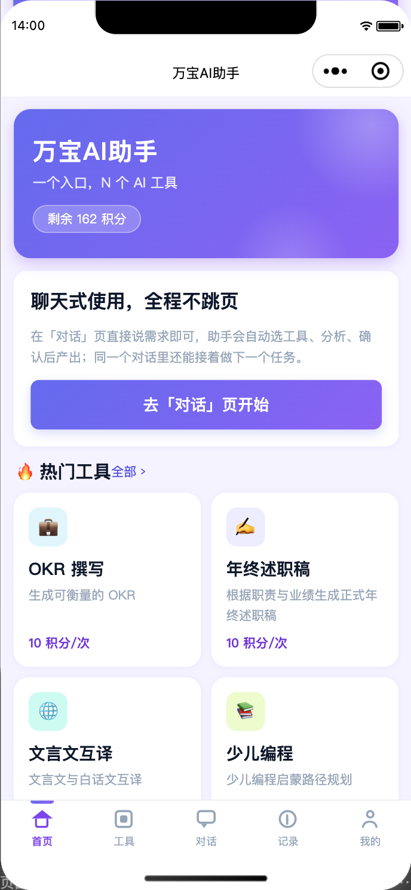
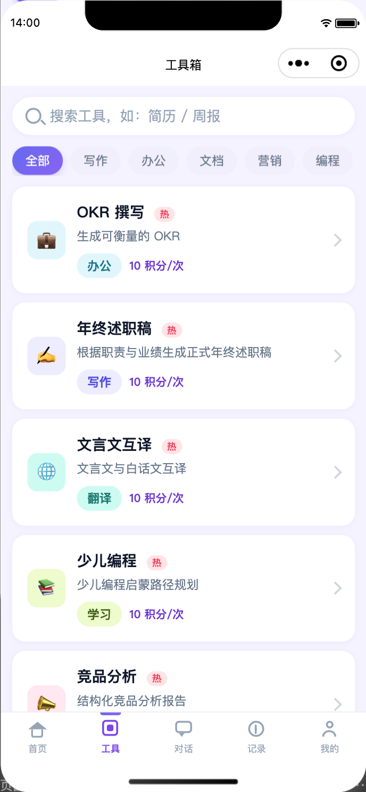
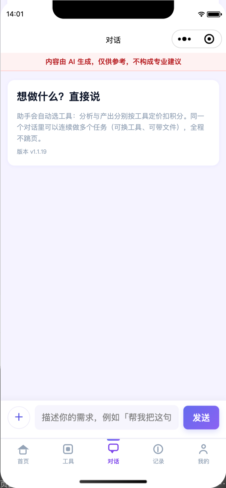

# 万宝AI助手 · 小程序端

## 目录

- [截图](#截图)
- [特性](#特性)
- [部署指南](#部署指南)
  - [1. 前置要求](#1-前置要求)
  - [2. 开发调试](#2-开发调试)
  - [3. 域名与-https](#3-域名与-https)
  - [4. 支付与积分](#4-支付与积分)
  - [5. 提审与发布](#5-提审与发布)
  - [6. 常见问题](#6-常见问题)
- [需要注意的权限](#需要注意的权限)
- [联系作者](#联系作者)
- [License](#license)

「万宝AI助手」的微信小程序前端（原生小程序，无第三方框架）。用户用自然语言描述需求，Agent 自动识别意图、调度工具、多轮追问并生成结果——本仓库是它的用户端界面，服务端在 [wanbao-backend](../wanbao-backend) 仓库。

## 截图

| 首页 | 工具 | 对话 |
|---|---|---|
|  |  |  |

## 特性

- **单页对话式体验**：自由描述需求 → 意图识别 → 多轮追问 → 就地确认扣费 → 流式产出，全程不跳页
- **工具目录**：分类浏览 + 语义搜索（服务端向量召回 + 关键词加权）
- **多模态附件**：聊天文件 / 相册选图 / 拍照三入口，图片直达视觉模型
- **邀请裂变**：小程序码 + 邀请海报（canvas 生成）+ 朋友圈分享
- **虚拟支付**：微信小程序虚拟支付（个人主体可开通），积分充值即买即用
- **合规内建**：AI 生成内容显著标识（顶部提示条 + 逐条角标）、隐私授权清单、协议页
- **多渠道矩阵**：同一套代码可以复制部署为多个小程序（各自 AppID），共用一个后端，工具货架与收款按渠道独立——见后端仓库「多渠道与多账户」

## 部署指南

### 1. 前置要求

1. [微信开发者工具](https://developers.weixin.qq.com/miniprogram/dev/devtools/download.html)（已登录）
2. 已部署的 [wanbao-backend](../wanbao-backend)（本地或公网均可，部署指南见后端仓库）
3. 一个微信小程序 AppID（个人主体即可，无需认证也可跑通开发调试）

### 2. 开发调试

1. 克隆本仓库，用微信开发者工具**导入整个目录**
2. 「详情 → 基本信息」把 AppID 换成你的（或先用测试号）
3. 修改 `app.js` 中的 `baseUrl` 指向你的后端：
   ```js
   baseUrl: "https://your-backend.example.com",
   ```
4. 编译即可进入首页，工具列表由后端种子数据驱动

调试提示：

- 模拟器中 wx.login 自动完成；若后端渠道未配 appid/secret，登录走 mock_openid 也能进全流程
- 想不配 LLM 供应商就体验完整链路：后端 `.env` 置 `LLM_MOCK=1`，输出为占位文本但扣费/会话/后台全部可通

### 3. 域名与 HTTPS

- 小程序要求 **HTTPS + ICP 备案域名**：把后端域名加入小程序后台「开发管理 → 开发设置 → 服务器域名」的 **request 合法域名**
- 开发阶段可在开发者工具勾选「不校验合法域名」临时绕过，**提审前必须去掉**

### 4. 支付与积分

- 充值走 `wx.requestVirtualPayment`（虚拟支付），**个人主体即可开通**：小程序后台「支付与交易 → 虚拟支付」，拿到 OfferID/AppKey 后填到后端管理后台「渠道账号」
- 开通前可由后端 `PAYMENT_MOCK` 模拟支付成功，跑通充值-积分-扣费全流程

### 5. 提审与发布

1. 上传体验版，走完「首页 → 工具 → 对话 → 充值」自测
2. 小程序后台更新**隐私指引**（参照 [docs/隐私权限申请清单.md](docs/隐私权限申请清单.md) 逐项核对，只勾实际在用的）
3. 类目选择：工具类即可；**若开放 AI 问答/生成功能，需企业主体的「深度合成」类目**（个人主体审核必驳回）
4. 提交审核 → 发布

### 6. 常见问题

| 现象 | 原因与处理 |
|---|---|
| 请求全部失败 | 合法域名未配 / baseUrl 写错 / 后端未起 |
| 保存海报报 fail api scope is not declared | 隐私指引未勾选相册写入权限，重新提交隐私指引 |
| 充值拉不起支付 | 渠道账号未配虚拟支付密钥，或 `PAYMENT_MOCK` 未关且未走模拟端点 |
| 图片/附件上传失败 | S3 未配置或 `uploadFile` 域名未加入合法域名 |

## 需要注意的权限

项目按「最小必要」申请隐私权限，清单见 [docs/隐私权限申请清单.md](docs/隐私权限申请清单.md)。二次开发若启用新能力（如录音语音输入），记得同步在小程序后台更新隐私指引并在代码中调用对应 API。

## 联系作者

- 技术问题 / Bug 反馈：请提 [Issue](../../issues)，方便沉淀给后来人
- 交流 / 合作：扫码添加微信（备注 GitHub）

<p align="center"></p>

## License

[MIT](LICENSE)
